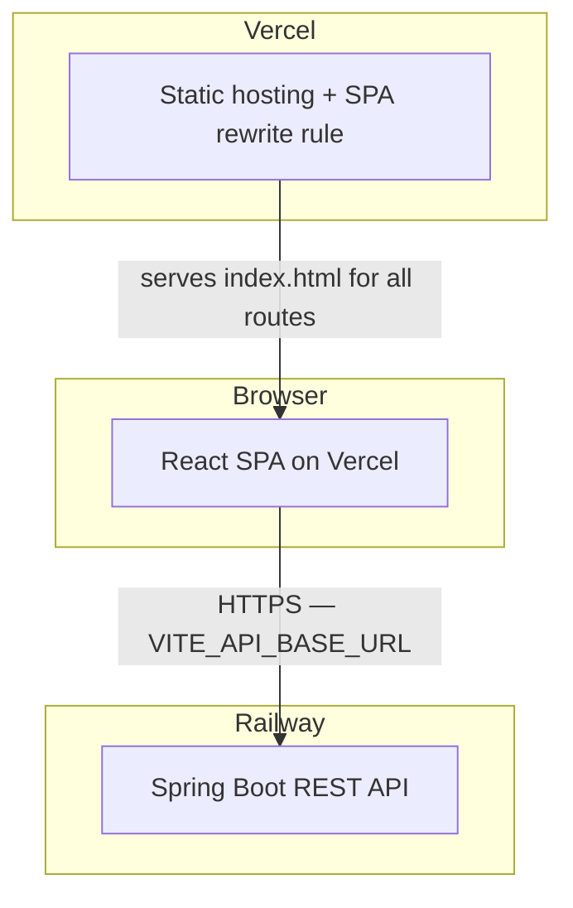

# Design Document

## Overview

This design covers the changes needed to make MedSoftIA v1 deployable to Vercel with its Spring Boot backend running on Railway. The work has two distinct parts:

1. **Code changes** — refactor the five service files and `axiosConfig.js` so that all API calls flow through a single shared Axios instance whose `baseURL` is controlled by a Vite environment variable (`VITE_API_BASE_URL`), and add a build-time validation script that blocks a production build if the variable is missing or invalid.
2. **Config file additions** — add `vercel.json` (SPA fallback), `.nvmrc` (Node version pin), `.env.example` (variable documentation), and update `.gitignore`.

No GitHub Actions pipeline is needed; Vercel's Git integration handles CI/CD natively.

---

## Architecture



### Key Architectural Decision: Shared Axios Instance

Currently each service file imports `axios` directly and constructs absolute URLs against `http://localhost:8080`. The fix is to:

1. Turn `axiosConfig.js` into the **single source of truth** for the Axios instance by setting `baseURL` there.
2. Have every service file import from `axiosConfig.js` instead of `axios` directly.
3. Keep all relative paths in the service files (`/cita`, `/medico`, etc.) — `baseURL` handles the host.

This is a minimal-footprint change: service files only change their import and lose the `const REST_API_BASE_URL` constant; the actual call signatures remain identical.

---

## Components and Interfaces

### 1. `src/services/axiosConfig.js` (modified)

Becomes the shared Axios instance. Responsibilities after the change:

- Create an Axios instance with `baseURL: import.meta.env.VITE_API_BASE_URL`.
- Attach the JWT Bearer token via a request interceptor (existing logic, unchanged).
- Handle 401 responses by clearing `localStorage` and redirecting to `/signin` (existing logic, unchanged).
- **Export the instance as the default export**, replacing the current `export default axios`.

```js
// src/services/axiosConfig.js  (after change)
import axios from 'axios';

const api = axios.create({
  baseURL: import.meta.env.VITE_API_BASE_URL,
});

api.interceptors.request.use((config) => {
  const token = localStorage.getItem('token');
  if (token) config.headers.Authorization = `Bearer ${token}`;
  return config;
});

api.interceptors.response.use(
  (response) => response,
  (error) => {
    if (error.response?.status === 401) {
      localStorage.removeItem('token');
      localStorage.removeItem('usuario');
      if (window.location.pathname !== '/signin') {
        window.location.href = '/signin';
      }
    }
    return Promise.reject(error);
  }
);

export default api;
```

### 2. Service Files (5 files — modified imports only)

Each of the five service files currently:
- Imports `axios` from `'axios'` directly.
- Declares one or more `const *_API_BASE_URL = 'http://localhost:8080/...'` constants.
- Uses those constants to construct full URLs for every call.

After the change, each file:
- Imports the shared instance: `import api from './axiosConfig.js'` (or the relative path from each file's location; all services live in `src/services/`, so the import is `'./axiosConfig.js'`).
- Drops all `const *_API_BASE_URL` constants.
- Replaces `axios.get(...)`, `axios.post(...)`, etc., with `api.get(...)`, `api.post(...)`, using **relative paths** (e.g., `'/cita'`, `'/medico'`).

No changes to function names, parameters, or return types — callers are unaffected.

**Mapping of paths per service file:**

| File | Paths used |
|---|---|
| `AuthService.js` | `/auth/login`, `/auth/me`, `/auth/password`, `/auth/recuperar/solicitar`, `/auth/recuperar/validar`, `/auth/recuperar/restablecer` |
| `CitasService.js` | `/cita`, `/cita/estado/:estado`, `/cita/:id`, `/cita/disponibilidad`, `/cita/medico/:id/estado/:estado`, `/medico` |
| `MedicosService.js` | `/medico`, `/medico/:id`, `/medico/:id/estado`, `/especialidad`, `/consultorio` |
| `PacientesService.js` | `/paciente`, `/paciente/documento/:doc`, `/paciente/:id` |
| `UsuariosService.js` | `/usuario`, `/usuario/:id`, `/usuario/:id/estado` |

### 3. `scripts/check-env.js` (new file)

A Node.js script invoked by the `prebuild` npm hook to validate `VITE_API_BASE_URL` only during production builds. The `prebuild` script runs automatically before `npm run build`.

```js
// scripts/check-env.js
const url = process.env.VITE_API_BASE_URL;

if (!url || url.trim() === '') {
  console.error('[check-env] ERROR: VITE_API_BASE_URL is not set.');
  process.exit(1);
}
if (!url.startsWith('https://')) {
  console.error(`[check-env] ERROR: VITE_API_BASE_URL must start with https:// — got: "${url}"`);
  process.exit(1);
}
if (url.includes('localhost')) {
  console.error(`[check-env] ERROR: VITE_API_BASE_URL must not contain localhost in production — got: "${url}"`);
  process.exit(1);
}

console.log(`[check-env] OK — VITE_API_BASE_URL=${url}`);
```

The script is only wired to `prebuild`, so `npm run dev` is unaffected.

### 4. `package.json` (scripts section — modified)

```json
"scripts": {
  "dev":      "vite",
  "prebuild": "node scripts/check-env.js",
  "build":    "vite build",
  "lint":     "eslint .",
  "preview":  "vite preview"
}
```

> `lint` remains a separate script and is not part of `build` per Requirement 2.2. The `prebuild` hook only runs the env check.

### 5. `vercel.json` (new file)

Implements the SPA fallback (Requirement 3.1) and declares the framework preset.

```json
{
  "framework": "vite",
  "rewrites": [
    { "source": "/((?!.*\\.).*)", "destination": "/index.html" }
  ]
}
```

The regex `/((?!.*\\.).*)`  matches any path that does not contain a dot (i.e., not a static asset), routing it to `index.html` so React Router handles the navigation client-side.

### 6. `.nvmrc` (new file)

```
20
```

Node 20 LTS is compatible with Vite 8 (Node ≥ 18 required) and is widely available on Vercel. This satisfies Requirement 4.1.

### 7. `.env.example` (new file)

```
# URL base del backend en producción.
# Copia este archivo como .env.local para desarrollo local.
VITE_API_BASE_URL=https://your-api.up.railway.app
```

No real or sensitive values are stored here. The file is committed to the repository. `.env.local` and `.env.production` are excluded from Git.

### 8. `.gitignore` (modified)

Add the missing patterns under the existing `# ===== ENV =====` block:

```
# ===== ENV =====
.env
.env.local
.env.production
.env.production.local
```

`.env.example` is intentionally not listed, so it remains tracked.

---

## Data Models

This feature does not introduce new data models. The key configuration values are:

| Artifact | Type | Value |
|---|---|---|
| `VITE_API_BASE_URL` | Vite build-time env var | `https://springboot-api-production-6f09feec.up.railway.app` |
| `CORS_ORIGINS` (Railway) | Backend env var | `https://<stable-vercel-domain>` |
| `FRONTEND_URL` (Railway) | Backend env var | `https://<stable-vercel-domain>` |
| Node version (`.nvmrc`) | String | `20` |

The JWT token and user object stored in `localStorage` are unchanged — `axiosConfig.js` continues to read `localStorage.getItem('token')` via the request interceptor.

---

## Error Handling

### Build-time errors

| Condition | Behavior |
|---|---|
| `VITE_API_BASE_URL` not set or empty | `scripts/check-env.js` exits 1 with descriptive message; `vite build` never runs |
| `VITE_API_BASE_URL` does not start with `https://` | Same — exits 1 |
| `VITE_API_BASE_URL` contains `localhost` | Same — exits 1 |

### Runtime errors (unchanged logic, now flowing through shared instance)

| Condition | Behavior |
|---|---|
| Backend returns 401 | Response interceptor in `axiosConfig.js` removes `token` and `usuario` from `localStorage`, redirects to `/signin` |
| Backend returns other 4xx/5xx | Error propagates to the calling component; components already display error messages via the Toast context |
| Network failure | Axios rejects the promise; components handle via existing `catch` blocks |

### Vercel routing

| Request | Vercel behavior |
|---|---|
| Path matches a static asset (contains `.`) | Served directly |
| Any other path (e.g., `/dashboard/citas`, `/signin`) | Rewritten to `/index.html`; React Router renders the correct component |

---

## Testing Strategy

This feature is primarily **deployment configuration and a code migration** (changing imports and removing hardcoded URLs). It falls into the category where property-based testing is not appropriate — there is no pure function with a wide input space to test. The right approach is example-based unit tests for the validation script and integration smoke tests for the deployed application.

Property-based testing is skipped because:
- The env validation script is a simple conditional check on a single string — not a function with a meaningful "for all inputs" property.
- The Axios `baseURL` wiring is configuration, not transformational logic.
- The `vercel.json` rewrite rule is declarative infrastructure.

### Unit tests — `scripts/check-env.js`

These tests cover the three validation branches directly, using Node's `process.env` and checking exit behavior. No test framework is strictly required; a minimal script works, though **Vitest** is the natural choice given the Vite toolchain.

| Test case | Input | Expected outcome |
|---|---|---|
| Valid URL | `VITE_API_BASE_URL=https://api.example.com` | Exits 0, logs "OK" |
| Variable not set | _(undefined)_ | Exits 1, message names the variable |
| Empty string | `VITE_API_BASE_URL=` | Exits 1 |
| `http://` URL | `VITE_API_BASE_URL=http://api.example.com` | Exits 1, message notes `https://` requirement |
| `localhost` URL | `VITE_API_BASE_URL=https://localhost:8080` | Exits 1, message notes localhost is disallowed |

### Integration / smoke tests (manual, post-deploy checklist)

These are executed manually after deployment using the browser and DevTools. They correspond directly to the Post-Deploy Checklist in `requirements.md`:

1. **Login succeeds** — POST to `/auth/login` goes to Railway, JWT is stored, user is redirected by role.
2. **Zero localhost requests** — Network tab shows no requests to `localhost:8080`.
3. **No CORS errors** — Console shows no `Access-Control-Allow-Origin` errors.
4. **Route refresh works** — Navigating directly to `/dashboard/citas` returns 200 and renders the dashboard (not a 404).
5. **Unauthenticated refresh redirects** — Accessing `/dashboard/citas` without a JWT redirects to `/signin`.
6. **Password recovery link** — Email link opens `/restablecer-contrasena?token=...` on the Vercel domain and renders the form.

### Build verification (local, pre-push)

```bash
# Should exit 1 (no variable set):
npm run build

# Should exit 0 and produce dist/:
VITE_API_BASE_URL=https://springboot-api-production-6f09feec.up.railway.app npm run build

# Lint should pass independently:
npm run lint
```
